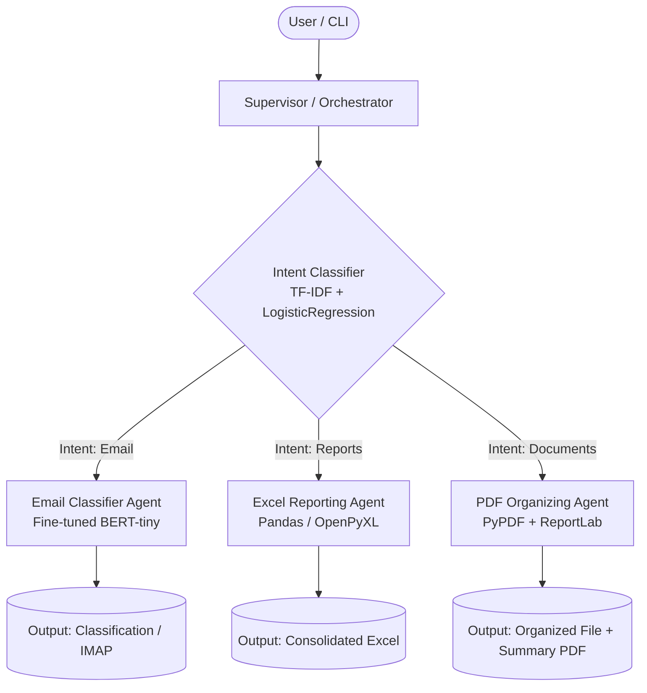

# Artificial Intelligence Multi-Agent System for Administrative Automation

[](https://www.python.org/)
[](#system-architecture)

Multi-agent system developed in Python for the automation, semantic classification, and processing of administrative tasks. The project implements a fine-tuned small language model (SLM), natural language processing (NLP) techniques, automated spreadsheet consolidation, and PDF document synthesis.

---

## Table of Contents

- [General Description](#general-description)
- [System Architecture](#system-architecture)
- [Project Structure](#project-structure)
- [Prerequisites](#prerequisites)
- [Installation and Configuration](#installation-and-configuration)
- [Usage Guide](#usage-guide)
- [Modules and Agents](#modules-and-agents)
- [Technologies Used](#technologies-used)
- [License](#license)

---

## General Description

The objective of this project is to reduce operational workload in recurrent administrative tasks through the coordination of specialized software agents.

Unlike solutions that rely exclusively on large-scale external commercial APIs, this system prioritizes the use of compact and efficient local models (BERT-tiny), ensuring fast inference, low computational resource consumption, and greater privacy over processed data.

---

## System Architecture

The system implements a hierarchical orchestration pattern (Supervisor-Workers):

```
User (CLI)
      |
      v
Central Supervisor (TF-IDF Intent Router + Logistic Regression)
      |
      +---> Classifier Agent (Fine-tuned BERT-tiny / IMAP)
      |
      +---> Reporting Agent (Consolidation and metrics in Excel)
      |
      +---> Organizing Agent (Extraction, classification, and summary PDF generation)
```

The system follows a **Centralized Orchestration (Supervisor-Workers)** pattern:



1. **Supervisor:** Receives natural language instructions from the user, determines the required task, and delegates it to the corresponding tool.
2. **Classifier Agent:** Processes email text (manually or by extracting them via IMAP) and classifies them into: Invoicing, Technical Support, Human Resources, Sales, or Notifications.
3. **Reporting Agent:** Reads multiple Excel files, standardizes their structure, cleans data, and generates a consolidated spreadsheet with statistical metrics.
4. **Organizing Agent:** Reads PDF files, extracts their content, determines their category, generates a structured summary, and creates a new executive PDF report.

---

## Project Structure

```text
Ing-Software-agent/
|-- entrenar_bert.py                  # BERT-tiny fine-tuning and training script
|-- main.py                           # Interactive console entry point (CLI)
|-- README.md                         # Main project documentation
|-- requirements.txt                  # Project dependencies
|
|-- datos/                            # Datasets for training and evaluation
|   |-- correos_etiquetados.csv       # Main classified emails dataset
|   `-- correos_prueba_externa.csv    # External test set
|
|-- modelos/
|   `-- bert_tiny_correos/            # Fine-tuned BERT-tiny model weights and tokenizer
|
|-- resultados/                       # Model training evaluation
|   |-- matriz_confusion_bert.png     # Confusion matrix plot
|   |-- metricas.json                 # Precision, recall, and F1-score metrics
|   `-- reporte.txt                   # Textual classification report
|
`-- src/                              # Modularized source code
    |-- __init__.py
    |-- config.py                     # Configuration and global path loader
    |
    |-- supervisor/                   # Orchestration module
    |   |-- __init__.py
    |   |-- clasificador_intencion.py # NLP intent classifier
    |   `-- orquestador.py            # Supervisor and routing tools
    |
    `-- agentes/                      # Specialized agent implementations
        |-- __init__.py
        |-- agente_clasificador.py    # Email classification and IMAP integration
        |-- agente_reportes.py        # Excel processing and consolidation
        `-- agente_organizador.py     # PDF analysis and generation with ReportLab
```

---

## Prerequisites

- Python 3.10 or higher installed on the system.
- Terminal environment (PowerShell, Bash, or CMD).
- For reading real emails via IMAP: an email account with application password authentication enabled (Gmail, Outlook, etc.).

---

## Installation and Configuration

### 1. Clone the repository

```bash
git clone https://github.com/TMXVJ/Multi-Agent-System.git
cd Ing-Software-agent
```

### 2. Create and activate the virtual environment

On Windows (PowerShell):
```powershell
python -m venv AgentVENV
.\AgentVENV\Scripts\activate
```

On Linux or macOS:
```bash
python3 -m venv AgentVENV
source AgentVENV/bin/activate
```

### 3. Install dependencies

```bash
pip install -r requirements.txt
```

### 4. Environment variables

Create a `.env` file in the root of the project based on the following template:

```ini
HF_TOKEN=your_optional_token
EMAIL_USER=your_email@gmail.com
EMAIL_PASS=your_app_password
```

---

## Usage Guide

To start the interactive system, run:

```bash
python main.py
```

### Execution options:

- **Demonstration mode (`demo`):** Runs a predefined test suite that evaluates the performance of the three agents with sample data.
- **Natural language queries:** Type free-form instructions into the console. The supervisor will identify the intent automatically. Examples:
  - *"Classify this email: Dear team, attached is the payment proof for this month's invoice."*
  - *"Check recent unread emails in my inbox."*
  - *"Consolidate sales files located in the reports folder."*
  - *"Organize this PDF document and generate an executive summary."*
- **Exit (`salir`):** Closes the interactive console session.

---

## Modules and Agents

### Supervisor (src/supervisor)
- **ClasificadorIntencion:** Uses TF-IDF vector representations and a Logistic Regression classifier trained on a corpus of typical commands in Spanish. Maps each request to its corresponding intent (emails, reports, or documents).
- **Orquestador:** Exposes functions as tools and coordinates execution, returning responses to the user.

### Classifier Agent (src/agentes/agente_clasificador.py)
- Employs a fine-tuned `prajjwal1/bert-tiny` model to classify text into 5 business categories.
- Includes integration with the IMAP protocol (`imaplib`) to extract and analyze unread emails directly from a mail server.

### Reporting Agent (src/agentes/agente_reportes.py)
- Reads collections of spreadsheet files (`.xlsx`, `.xls`).
- Consolidates information into a single DataFrame, generates statistical analyses for numerical variables and categorical frequency distributions, and exports results into a new Excel workbook with dedicated sheets.

### Organizing Agent (src/agentes/agente_organizador.py)
- Extracts text and metadata from PDF documents using `pypdf`.
- Identifies the document's subject and administrative category via frequency analysis and semantic rules.
- Generates a formal PDF document containing the text summary using the `reportlab` library.

---

## Technologies Used

- **Language:** Python
- **Language Models and NLP:** Hugging Face Transformers, PyTorch, Scikit-learn
- **Data Analysis:** Pandas, OpenPyXL
- **Document Generation and Extraction:** ReportLab, PyPDF
- **Network Protocols:** IMAP (imaplib, email)
- **Configuration Management:** Python-dotenv

---

## License

All Rights Reserved TMXVJ