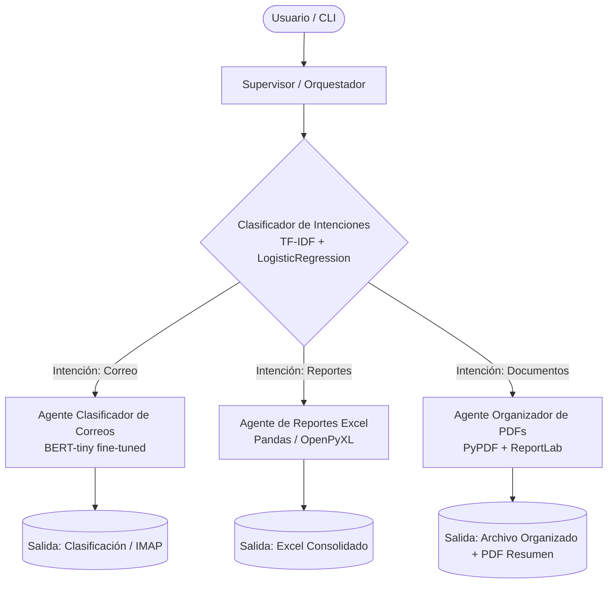

# Sistema Multiagente Basado en Inteligencia Artificial para Automatizacion Administrativa

[](https://www.python.org/)
[](LICENSE)
[](#arquitectura-del-sistema)

Sistema multiagente desarrollado en Python para la automatizacion, clasificacion semantica y procesamiento de tareas administrativas. El proyecto implementa un modelo de lenguaje pequeno (SLM) ajustado mediante fine-tuning, tecnicas de procesamiento de lenguaje natural (NLP), consolidacion automatizada de hojas de calculo y sintesis de documentos PDF.

---

## Tabla de Contenidos

- [Descripcion General](#descripcion-general)
- [Arquitectura del Sistema](#arquitectura-del-sistema)
- [Estructura del Proyecto](#estructura-del-proyecto)
- [Requisitos Previos](#requisitos-previos)
- [Instalacion y Configuracion](#instalacion-y-configuracion)
- [Guia de Uso](#guia-de-uso)
- [Modulos y Agentes](#modulos-y-agentes)
- [Tecnologias Utilizadas](#tecnologias-utilizadas)
- [Licencia](#licencia)

---

## Descripcion General

El objetivo de este proyecto es reducir la carga operativa en tareas administrativas recurrentes mediante la coordinacion de agentes de software especializados. 

A diferencia de soluciones que dependen exclusivamente de APIs comerciales externas de gran escala, este sistema prioriza el uso de modelos locales compactos y eficientes (BERT-tiny), garantizando rapidez de inferencia, bajo consumo de recursos computacionales y mayor privacidad sobre la informacion procesada.

---

## Arquitectura del Sistema

El sistema implementa un patron de orquestacion jerarquica (Supervisor-Trabajadores):

```
Usuario (CLI)
      |
      v
Supervisor Central (Enrutador de Intenciones TF-IDF + Regresion Logistica)
      |
      +---> Agente Clasificador (BERT-tiny fine-tuned / IMAP)
      |
      +---> Agente de Reportes (Consolidacion y metricas en Excel)
      |
      +---> Agente Organizador (Extraccion, clasificacion y generacion de PDF resumen)

El sistema sigue un patrón de **Orquestación Centralizada (Supervisor-Workers)**:


```

1. **Supervisor:** Recibe la instruccion en lenguaje natural del usuario, determina que tarea se requiere y la delega a la herramienta correspondiente.
2. **Agente Clasificador:** Procesa el texto de correos electronicos (manualmente o extrayendolos por IMAP) y los cataloga en: Facturacion, Soporte Tecnico, Recursos Humanos, Ventas o Notificaciones.
3. **Agente de Reportes:** Lee multiples archivos de Excel, unifica su estructura, limpia los datos y genera un libro de calculo consolidado con metricas estadisticas.
4. **Agente Organizador:** Lee archivos PDF, extrae su contenido, determina su categoria, elabora una sintesis estructurada y crea un nuevo PDF ejecutivo con el reporte.

---

## Estructura del Proyecto

```text
Ing-Software-agent/
|-- entrenar_bert.py                  # Script de entrenamiento y fine-tuning de BERT-tiny
|-- main.py                           # Punto de entrada interactivo por consola (CLI)
|-- README.md                         # Documentacion principal del proyecto
|-- requirements.txt                  # Dependencias del proyecto
|
|-- datos/                            # Datasets para entrenamiento y evaluacion
|   |-- correos_etiquetados.csv       # Dataset principal de correos clasificados
|   `-- correos_prueba_externa.csv    # Conjunto de prueba externa
|
|-- modelos/
|   `-- bert_tiny_correos/            # Pesos y tokenizador del modelo BERT-tiny ajustado
|
|-- resultados/                       # Evaluacion del entrenamiento del modelo
|   |-- matriz_confusion_bert.png     # Grafica de matriz de confusion
|   |-- metricas.json                 # Metricas de precision, recall y F1-score
|   `-- reporte.txt                   # Reporte textual de clasificacion
|
`-- src/                              # Codigo fuente modularizado
    |-- __init__.py
    |-- config.py                     # Carga de configuracion y rutas globales
    |
    |-- supervisor/                   # Modulo de orquestacion
    |   |-- __init__.py
    |   |-- clasificador_intencion.py # Clasificador de intenciones por NLP
    |   `-- orquestador.py            # Supervisor y herramientas de enrutamiento
    |
    `-- agentes/                      # Implementacion de agentes especializados
        |-- __init__.py
        |-- agente_clasificador.py    # Clasificacion de correos e integracion IMAP
        |-- agente_reportes.py        # Procesamiento y consolidacion de Excel
        `-- agente_organizador.py     # Analisis y generacion de PDFs con ReportLab
```

## Requisitos Previos

- Python 3.10 o superior instalado en el sistema.
- Entorno de terminal (PowerShell, Bash o CMD).
- Para la lectura de correos reales via IMAP: una cuenta de correo con autenticacion por contrasena de aplicacion habilitada (Gmail, Outlook, etc.).

---

## Instalacion y Configuracion

### 1. Clonar el repositorio

```bash
git clone https://github.com/TMXVJ/Multi-Agent-System.git
cd Ing-Software-agent
```

### 2. Crear y activar el entorno virtual

En Windows (PowerShell):
```powershell
python -m venv AgentVENV
.\AgentVENV\Scripts\activate
```

En Linux o macOS:
```bash
python3 -m venv AgentVENV
source AgentVENV/bin/activate
```

### 3. Instalar dependencias

```bash
pip install -r requirements.txt
```

### 4. Variables de entorno

Crea un archivo `.env` en la raiz del proyecto tomando como base el siguiente formato:

```ini
HF_TOKEN=tu_token_opcional
EMAIL_USER=tu_correo@gmail.com
EMAIL_PASS=tu_contrasena_de_aplicacion
```

---

## Guia de Uso

Para iniciar el sistema interactivo, ejecuta:

```bash
python main.py
```

### Opciones de ejecucion:

- **Modo demostracion (`demo`):** Ejecuta una bateria de pruebas predefinidas que evalua el funcionamiento de los tres agentes con datos de muestra.
- **Consultas en lenguaje natural:** Escribe instrucciones libres en la consola. El supervisor identificara la intencion automaticamente. Ejemplos:
  - *"Clasifica este correo: Estimado equipo, adjunto soporte de pago de la factura de este mes."*
  - *"Revisa los correos recientes de mi bandeja de entrada."*
  - *"Consolida los archivos de ventas que estan en la carpeta reportes."*
  - *"Organiza este documento PDF y genera un resumen ejecutivo."*
- **Salir (`salir`):** Finaliza la sesion de la consola interactiva.

---

## Modulos y Agentes

### Supervisor (src/supervisor)
- **ClasificadorIntencion:** Utiliza representacion vectorial TF-IDF y un clasificador de Regresion Logistica entrenado con un corpus de comandos tipicos en espanol. Asigna cada peticion a la intencion correspondiente (correos, reportes o documentos).
- **Orquestador:** Expone las funciones como herramientas y coordina la ejecucion retornando la respuesta al usuario.

### Agente Clasificador (src/agentes/agente_clasificador.py)
- Emplea un modelo `prajjwal1/bert-tiny` con ajuste de parametros (fine-tuning) para clasificar texto en 5 categorias de negocio.
- Incluye integracion con el protocolo IMAP (`imaplib`) para extraer y analizar correos no leidos directamente desde un servidor de correo electronico.

### Agente de Reportes (src/agentes/agente_reportes.py)
- Lee colecciones de archivos de hojas de calculo (`.xlsx`, `.xls`).
- Consolida la informacion en un unico DataFrame, genera analisis estadisticos de variables numericas y distribuciones de frecuencias categoricas, y exporta el resultado en un nuevo archivo Excel con hojas separadas.

### Agente Organizador (src/agentes/agente_organizador.py)
- Extrae texto y metadatos de documentos PDF mediante `pypdf`.
- Identifica la tematica y categoria administrativa del documento a traves de analisis de frecuencias y reglas semanticas.
- Genera un documento PDF formal con el resumen del texto utilizando la biblioteca `reportlab`.

---

## Tecnologias Utilizadas

- **Lenguaje:** Python
- **Modelos de Lenguaje y NLP:** Hugging Face Transformers, PyTorch, Scikit-learn
- **Analisis de Datos:** Pandas, OpenPyXL
- **Generacion y Lectura de Documentos:** ReportLab, PyPDF
- **Protocolos de Red:** IMAP (imaplib, email)
- **Gestion de Configuracion:** Python-dotenv

---

## Licencia

All Rights Reserved TMXVJ
